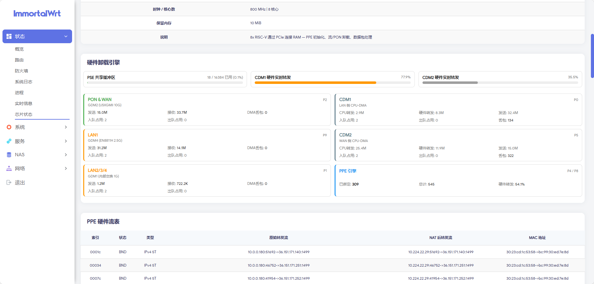
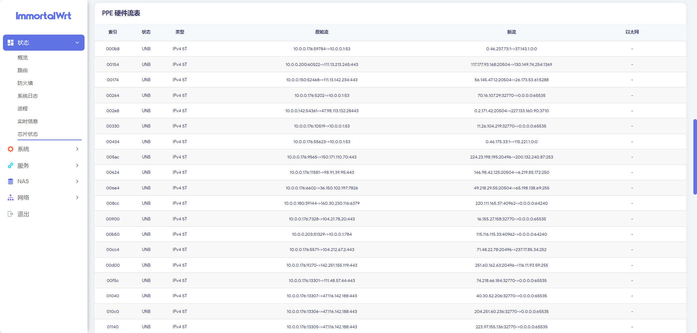

# luci-app-airoha-npu

Airoha AN7581 SoC 实时监测与管理面板，适用于 OpenWrt。涵盖 NPU 卸载、CPU 频率、Frame Engine 内部状态及 PPE 流表。

**[下载](https://github.com/DenzelVincent/luci-app-airoha-npu/releases/latest)**


## 界面截图

### CPU 频率与 NPU 状态


### 硬件卸载引擎


### PPE 配置寄存器


### PPE 流卸载表



## 功能特性

### CPU 频率管理
- 当前频率显示（可视化柱状图）
- 调度策略选择（performance、ondemand、schedutil 等）
- 从可用 OPP 条目中选择最大频率
- 直接 PLL 超频控制（500-1600 MHz），通过硬件寄存器编程实现
- 超频检测与不稳定频率警告

### NPU 与卸载引擎
- NPU 固件版本（TLB 格式）、时钟频率、核心数
- NPU 状态（已激活/未激活）及保留内存
- PPE 引擎摘要（已绑定 / 总计条目数 / 两端合计硬件转发占比）

### Frame Engine 可视化
- **PSE 共享缓冲区** — FQ 描述符池占用率（已用页 ÷ 池容量），拥塞指示
- **CDM1 / CDM2 硬件实时转发** — LAN 侧 / WAN 侧 CPU-DMA 通道的区间卸载率：`Δ(硬件转发) ÷ Δ(硬件转发 + CPU 路径)`
- **GDM 端口卡片** — 发送/接收（64 位累计帧数）、DMA 丢包（5 类 DMA 计数求和）、PSE 队列页占用与队列丢包：
  - GDM2：PON & WAN（USXGMII 10G）
  - GDM4：LAN1（EN8811H 2.5G）
  - GDM1：LAN2/3/4（内部交换 1G）
  - GDM3：WiFi DMA（仅在检测到无线 PHY 时显示）
- **PPE 引擎卡片** — 已绑定/总计流表条目数，以及两侧 CDM 区间增量加权的硬件转发占比
- 颜色编码：绿色（PON/WAN）、橙色（LAN）、紫色（WiFi）、灰色（CDM）、蓝色（PPE）
- 每个数值的含义、来源与算法见下方 [指标口径](#指标口径)

### PPE 配置寄存器
- 可折叠区域，显示 PPE 硬件转发引擎底层寄存器配置
- 用于调试和诊断

### PPE 流卸载表
- 显示前 100 条 PPE 条目，包含状态（BND/UNB/FIN）、类型（IPv4/IPv6 五元组、L2B 二层桥接）、原始转发流 / NAT 后转发流 / MAC 地址
- 排序：已绑定（BND）条目优先置顶，组内按表项槽位号（索引）升序
- 每 5 秒自动刷新

### 主题适配
- 运行时采样页面背景亮度，自动检测深色/浅色模式
- 兼容 Glass、Bootstrap、Bootstrap-dark 及所有 LuCI 主题
- 全程使用 CSS 自定义属性，无硬编码颜色

## 指标口径

Frame Engine 的所有数值都是直接从 AN7581 寄存器读出的硬件计数器（`devmem`，基址 `0x1fb50000`），页面每 5 秒轮询一次。理解口径前先区分两类值：

| 类型 | 含义 | 显示 |
|------|------|------|
| **累计值** | 寄存器自上次复位以来的累计计数，页面刷新不会变化 | 直接显示 |
| **区间值** | 本次轮询与上次轮询的差值（5 秒窗口），即实时速率 / 实时占比 | 百分比、"采样中"、"空闲" |

通用规则：

- 首次加载（没有上一帧基准）显示 **采样中**；差值出现负数（驱动重载或计数器回绕）同样显示 **采样中**，不输出异常百分比。
- 区间内增量为 0 显示 **空闲**。
- 大数缩写：`≥1,000,000` 显示为 `x.xM`，`≥1,000` 显示为 `x.xK`，保留一位小数；计数单位是**帧/包**，不是字节。
- 丢包累计值常态显示，只有本轮询有新增时才在数字后追加红色 `+N`，下一轮无新增即消失。

### GDM 端口（发送/接收/丢包）

每个 GDM 有一块 COUNT 块（GDM1 `0x1fb50600`、GDM2 `0x1fb51600`、GDM3 `0x1fb51200`、GDM4 `0x1fb52600`）：

| 字段 | 寄存器偏移 | 口径 |
|------|-----------|------|
| 发送 | `+0x04`（低 32 位）、`+0x180`（高 32 位） | `(H << 32) + L` 的 64 位累计帧数，先读高再读低 |
| 接收 | `+0x48`（低）、`+0x190`（高） | 同上，64 位累计帧数 |
| DMA 丢包 | `+0x08`（TX_DROP）、`+0x4c`（RX_FC）、`+0x50`（RX_RC）、`+0x54`（RX_OVER）、`+0x58`（RX_ERR） | **5 类 DMA 层计数求和**（累计）；TX_DROP 属发送方向，RX_* 属接收方向 |
| 队列丢包 | `PSE_DROP_CNT(P) = 0x1fb50120 + P×4` | 该 PSE 端口的累计队列丢包，仅在 > 0 时显示 |
| 入队 / 出队占用 | `PSE_PORT_Q_USE_STA(P) = 0x1fb50150 + P×4` | 瞬时值：`[30:16]` 为入队页数、`[14:0]` 为出队页数（各 15 位），单位是描述符页，不是包数 |

说明：

- 丢包**不含** `+0x18` / `+0x68` 的 ETH MIB 计数——那是内核 netdev `tx_dropped` / `rx_dropped` 的 MAC 层口径，与本卡片的 DMA 层口径不同，混加会重复。
- 端口号 `P` 采用上游 `enum fe_pse_port` 顺序：CDM1=0、GDM1=1、GDM2=2、GDM3=3、PPE1=4、CDM2=5、CDM3=6、CDM4=7、PPE2=8、GDM4=9。卡片角标显示的就是这个下标。
- GDM3（WiFi DMA）仅在检测到 `/sys/class/ieee80211/phy*` 时渲染；无无线模块的机型（如 XG-040G-MD）自动隐藏。

### CDM1 / CDM2（LAN 侧 / WAN 侧 CPU-DMA）

两块 CDM：CDM1 `0x1fb50500`（LAN 侧）、CDM2 `0x1fb51500`（WAN 侧）。

| 字段 | 寄存器偏移 | 口径 |
|------|-----------|------|
| 发送 | `+0x80` | 32 位累计帧数 |
| CPU 转发 | `+0x90`（RXCPU_OK） | 32 位累计帧数，走 CPU 协议栈的接收路径 |
| 硬件转发 | `+0x94`（RXHWF_OK）+ `+0x98`（RXHWF_FAST_ALL） | 两套**互斥**的卸载机制求和：CDM1 的桥接流量经 FAST_ALL，CDM2 的路由/PPE 流量经 RXHWF_OK；实测同一 CDM 上另一项恒为 0，相加不会重复计数 |
| 丢包 | `+0xa0`（RXCPU_DROP）+ `+0xa4`（RXHWF_DROP） | 仅 CPU 路径与 HWF 路径两路。`+0xa8`（RXHWF_FAST_DROP）是 RXHWF_DROP 的**子集**（实测两者恒等），只在悬浮明细展示，**不叠加**；`+0xac`（RXOQ5_DROP）是同一 HWF 队列的另一种视角，不参与 |
| 实时硬件转发占比 | 区间增量 | `Δ(RXHWF_OK + RXHWF_FAST_ALL) ÷ [Δ(两者合计) + Δ(RXCPU_OK)]`；>80% 绿、>50% 橙、其余灰 |

说明：

- TX 与 RXCPU/RXHWF 是同一 CDM 的两个方向，**单侧收发不守恒**；路由转发时入口和出口分别落在两侧 CDM，页面两侧合计才接近平衡。
- 有代理 / tproxy（如 OpenClash）截流时，流量改走 CPU 路径，硬件转发占比会明显下降，属正常现象。
- CDM 计数是 32 位字段，高速流量下可能回绕；前端检测到负增量即回到 **采样中**，不会显示错误百分比。

### PSE 共享缓冲区

- 统计对象是 **FQ 描述符池**：`FQ_CFG`（`0x1fb5008c`）低 15 位 = 池容量，`FQ_STA`（`0x1fb50108`）低 15 位 = 当前空闲页数。
- 已用 = 容量 − 空闲；百分比 = 已用 ÷ 容量。
- 颜色：>80% 红、>50% 橙、其余绿。
- **不使用** `0x104`（`SHARE_BUF_STA`）：其高位在 AN7581 上不会回落到真实占用，掩码后的值可能超过池容量，据此算出的百分比是假信号。

### PPE 引擎与流表

- **已绑定 / 总计**：分别统计 `/sys/kernel/debug/ppe/bind` 与 `/sys/kernel/debug/ppe/entries` 中以十六进制槽位号开头的行数。
- **PPE 卡片的硬件转发占比**：把两端 CDM 的区间增量合并后计算 `Δ(hwf_cdm1 + hwf_cdm2) ÷ [Δ(hwf 合计) + Δ(rx_cpu 合计)]`，即按流量加权的真实卸载比例，不是两条 CDM 进度条的算术平均。卡片角标 `P4 / P8` 对应 PPE1 / PPE2 的 PSE 端口下标。
- **流表**：取 `entries` 的前 100 条；**BND（已绑定）置顶**，组内按槽位号升序。列含义：
  - `原始转发流` ← `orig=`，进入 PPE 时的五元组 / 二层桥接键
  - `NAT 后转发流` ← `new=`，NAT 或转换后的五元组（无转换时与 orig 相同）
  - `MAC 地址` ← `eth=`，全零显示为 `-`
- **注意**：BND 条目的 `packets` / `bytes` 可能长期为 0——FAST 桥接流量不写入 PPE entries。判断实际卸载量请以 CDM 计数器为准，不要用流表包数衡量吞吐。

### CPU 频率与超频

- 当前频率读 `cpufreq/policy0/cpuinfo_cur_freq`（硬件实际值），进度条为 `(当前 − 最小) ÷ (最大 − 最小) × 100%`，夹在 0–100。
- cpufreq 不可用时回退读 PLL 寄存器并标注 `PLL Estimate`。
- PLL 频率：`0x1fa202b4` 的 `[30:24]` 为 `pcw_int`，`0x1fa202b8` 的 `[6:4]` 为 `posdiv`，`freq = pcw_int × 50 ÷ 2^posdiv`（posdiv = 0 时即 `pcw_int × 50`）。
- 超频范围 500–1600 MHz，写入前锁定 performance 策略，按 10 步寄存器序列写入；任一步失败即回滚全部已写寄存器。

### NPU 状态

- 固件版本：`/proc/device-tree/soc/npu@1e900000/firmware-name`，再从固件文件 `strings` 中提取 TLB 版本串。
- 运行状态：`/sys/bus/platform/drivers/airoha-npu/*.npu` 是否存在。
- 时钟频率：`/sys/kernel/debug/clk/npu/clk_rate`。
- 核心数：`/proc/interrupts` 中 `airoha-npu-wdt` 行数。
- 保留内存：解析 `/proc/iomem`（`dmesg` 回退）中 NPU 相关 region 求和。

### 已知限制

- 桥接 / FAST 转发不进入 Linux netdev 的 `rx_bytes` / `tx_bytes`，不能用网卡字节数核对卸载量。
- PPE `entries` 在纯 FAST 桥接场景下可能是 0，属正常（卸载路径不经过 PPE 流表）。
- 计数回绕与驱动重载都表现为负增量，统一显示 **采样中**，不做跨回绕修正。

## 系统要求

- 搭载 LuCI 的 OpenWrt（24.10+）
- Airoha AN7581 目标平台（`@TARGET_airoha`）
- PPE debugfs（`/sys/kernel/debug/ppe/entries`）
- **`devmem`** busybox 小程序 — Frame Engine 寄存器访问和 CPU 超频必需（`CONFIG_BUSYBOX_DEFAULT_DEVMEM=y`）
- 可选：[air_tools](https://github.com/merbanan/air_tools) 脚本，用于更多 Frame Engine 调试功能

## 安装方法

> 仓库根目录是一个 **feed**（包本体在 `luci-app-airoha-npu/` 子目录里）。
> 这样组织是因为 `scripts/feeds` 的扫描是 `find -mindepth 1 ... -name Makefile`，
> 仓库根上的那份 Makefile 会被跳过，直接当 feed 用会"声明成功但一个包都装不上"。

### 作为 feed 集成到 OpenWrt 编译（推荐）
```sh
# 1. 声明 feed
echo 'src-git airoha_npu https://github.com/DenzelVincent/luci-app-airoha-npu.git' >>feeds.conf.default

# 2. 更新并安装 feeds
./scripts/feeds update airoha_npu
./scripts/feeds install -a

# 3. 在 menuconfig 中启用（LuCI -> Applications -> luci-app-airoha-npu）
make menuconfig

# 4. 编译；feed 来的包产物落在 bin/packages/<arch>/airoha_npu/
make package/luci-app-airoha-npu/compile V=s
```

### 直接拷进编译树
```sh
# 添加到编译树（注意取的是仓库里的同名子目录，不是仓库根）
git clone https://github.com/DenzelVincent/luci-app-airoha-npu.git /tmp/airoha-npu
ln -s /tmp/airoha-npu/luci-app-airoha-npu package/luci-app-airoha-npu

# 在 menuconfig 中启用
make menuconfig
# 导航至：LuCI -> Applications -> luci-app-airoha-npu

# 编译
make package/luci-app-airoha-npu/compile V=s
```

### 使用 SDK 独立编译 APK 包
```sh
# 1. 下载 ImmortalWrt SDK（仅 snapshots 提供 airoha-an7581 SDK）
wget https://downloads.immortalwrt.org/snapshots/targets/airoha/an7581/immortalwrt-sdk-airoha-an7581.Linux-x86_64.tar.zst
tar --use-compress-program=unzstd -xf immortalwrt-sdk-*.tar.zst
cd immortalwrt-sdk-*

# 2. 把包本体放进 SDK 的 package 目录（仓库根是 feed，取的是同名子目录）
git clone --depth 1 https://github.com/DenzelVincent/luci-app-airoha-npu.git /tmp/airoha-npu
cp -R /tmp/airoha-npu/luci-app-airoha-npu package/

# 3. 更新 feeds
./scripts/feeds update -a
./scripts/feeds install -a

# 4. 编译软件包
make defconfig
make package/luci-app-airoha-npu/compile V=s

# 5. 输出 APK 在 bin/packages/ 目录下
ls bin/packages/aarch64_generic/base/luci-app-airoha-npu_*.apk
```

### 手动安装（开发调试）
```sh
# 将文件复制到路由器
scp luci-app-airoha-npu/root/usr/libexec/rpcd/luci.airoha_npu root@router:/usr/libexec/rpcd/
scp luci-app-airoha-npu/root/usr/share/luci/menu.d/luci-app-airoha-npu.json root@router:/usr/share/luci/menu.d/
scp luci-app-airoha-npu/root/usr/share/rpcd/acl.d/luci-app-airoha-npu.json root@router:/usr/share/rpcd/acl.d/
scp luci-app-airoha-npu/htdocs/luci-static/resources/view/airoha_npu/status.js root@router:/www/luci-static/resources/view/airoha_npu/

# 设置权限并重启 rpcd
ssh root@router 'chmod +x /usr/libexec/rpcd/luci.airoha_npu && /etc/init.d/rpcd restart'
```

### 一键调试脚本（推荐）
```sh
# 使用 scp_deploy.sh 一键部署（只需输入一次密码）
./scp_deploy.sh 192.168.1.1 root

# 参数说明：
#   $1 - 路由器 IP（默认 192.168.1.1）
#   $2 - SSH 用户名（默认 root）

# 部署完成后浏览器打开：
# http://192.168.1.1/cgi-bin/luci/admin/status/npu
# 提示：Ctrl+Shift+R 硬刷新以加载最新 JS
```

## 数据来源

| 数据 | 来源 | 是否必需 |
|------|------|----------|
| NPU 状态 / 固件 / 保留内存 | `/sys/bus/platform/drivers/airoha-npu/`、`/proc/device-tree`、`/proc/iomem`、`dmesg` | 是 |
| NPU 时钟 | `/sys/kernel/debug/clk/npu/clk_rate` | 是 |
| CPU 频率 / 温度 / 核数 | `/sys/devices/system/cpu/cpufreq/policy0/`、`/sys/class/thermal/`、`/sys/devices/system/cpu/cpu[0-9]*` | 是 |
| 超频 PLL | `devmem` 寄存器 `0x1fa202b4`（pcw_int）、`0x1fa202b8`（posdiv） | devmem |
| PPE 条目 / 绑定 | `/sys/kernel/debug/ppe/{entries,bind}` | 是 |
| PPE 配置寄存器 | `/sys/kernel/debug/ppe/config` | 是 |
| Frame Engine GDM | `devmem` COUNT 块 `0x1fb50600` / `0x1fb51600` / `0x1fb51200` / `0x1fb52600` | devmem |
| Frame Engine CDM | `devmem` `0x1fb50500`（CDM1）/ `0x1fb51500`（CDM2） | devmem |
| Frame Engine PSE | `devmem` 队列状态 `0x1fb50150+P×4`、丢包 `0x1fb50120+P×4`、FQ 池 `0x1fb5008c` / `0x1fb50108` | devmem |

## 项目结构

```
luci-app-airoha-npu/                                  # 仓库根 = feed 源
├── luci-app-airoha-npu/                              # 包本体，scripts/feeds 扫这一层
│   ├── Makefile                                      # OpenWrt 软件包构建
│   ├── htdocs/
│   │   └── luci-static/resources/view/airoha_npu/
│   │       └── status.js                             # LuCI JavaScript 视图
│   ├── po/                                           # 界面翻译（zh_Hans / es / templates）
│   └── root/
│       └── usr/
│           ├── libexec/rpcd/
│           │   └── luci.airoha_npu                   # RPC 后端（Shell 脚本）
│           └── share/
│               ├── luci/menu.d/
│               │   └── luci-app-airoha-npu.json      # 菜单配置
│               └── rpcd/acl.d/
│                   └── luci-app-airoha-npu.json      # ACL 权限
├── .github/workflows/build-apk.yml                   # SDK 独立编译 APK 的工作流
├── scp_deploy.sh                                     # 免编译一键推送源文件的调试脚本
└── screenshots/                                      # 界面截图
```

## RPC 方法

| 方法 | 说明 | 参数 |
|------|------|------|
| `getStatus` | NPU 固件/版本/时钟/核数/保留内存、CPU 频率/策略/温度/核数、PPE 已绑定/总计 | — |
| `getPpeEntries` | PPE 流表条目的槽位、状态、类型、orig/new 五元组、eth 与包字节计数 | — |
| `getFrameEngine` | `pse_ports[]`（port/iq/oq/drops）、`fq_limit`/`fq_free`、`gdm1-4`（tx/rx/5 类丢包）、`cdm1-2`（tx/rx_cpu/rx_hwf/rx_hwf_fast/3 类丢包） | — |
| `setGovernor` | 更改 CPU 调度策略 | `governor` |
| `setMaxFreq` | 设置 CPU 最大频率 | `freq`（kHz） |
| `setOverclock` | 直接 PLL 频率设定（500–1600 MHz，含回滚） | `freq_mhz` |

## 版本历史

### v1.3.1
- PPE 流表列宽改为固定百分比 5/5/5/45/20/20，按实测文本宽度分配，轮询时不再抖动
- 第 4 列加宽后，表格宽度 ≥ 1220px 时 IPv6 长流不再折行
- 表头与单元格内容统一居中

### v1.3.0
- 硬件卸载引擎布局重构：双栏布局，GDM / CDM 卡片尺寸与间距统一
- 顶部新增三条实时进度条：CDM1（LAN 侧）、CDM2（WAN 侧）、PPE 引擎硬件转发占比
- PPE 引擎卡片卸载占比改为两侧 CDM 区间增量加权，不再取两条进度条的平均
- 接入 GDM3（WiFi DMA）计数，按无线 PHY 能力自动显隐
- GDM 发送/接收改为读取 64 位累计值，避免 32 位回绕
- PSE 缓冲占用改用 FQ 描述符池口径（已用页 ÷ 池容量），弃用不可信的 0x104 寄存器
- CDM 丢包只统计 CPU 路径 + 硬件转发路径，不再叠加 FAST 子集
- 丢包数字保持常态色，仅在本区间有新增时追加红色 `+N`
- README 新增「指标口径」章节

### v1.2.2
- UI 样式全面优化：三列等宽布局，统一 32px 行高，12px 字体
- 颜色分类：绿色 (PON/WAN)、橙色 (LAN)、灰色 (CDM)、蓝色 (PPE)
- PPE Config 折叠区域自定义样式，箭头旋转动画
- 入队/出队/丢包三列布局，统一格式
- 删除 deploy.ps1，保留 scp_deploy.sh 一键部署脚本
- 修复 GDM4 颜色编码（LAN1 2.5G 改为橙色）
- 修复 PPE 引擎卡片边框样式（改为左边框）
- CDM 卸载率改为 5 秒区间实时口径，并在卡片显示 CDM 自身丢包
- 更正芯片状态页访问地址为 /admin/status/npu

### v1.2.1
- 修复 PSE 端口映射表（修正 P0-P9 索引，补充缺失的 P9）
- 修复翻译字符串不匹配问题（更新 NPU 描述）
- 修复 JSON 输出中特殊字符的转义
- 修复 sleep 0.02 兼容性问题（改用 usleep）
- 修复 PPE 条目类型字段尾部空格
- 新增 dmesg 解析作为 /proc/iomem 的回退方案
- 新增超频失败回滚机制
- 新增 GDM3 计数器文档说明
- 改进 Argon 主题检测（支持浅色模式）
- 更新 README 版本徽章和下载链接

### v1.2.0
- 移除 XG-040G-MD 有线设备的 WiFi 相关功能
- 从 PSE 队列显示中移除 WiFi DMA 端口
- 更新纯有线以太网配置的 UI 描述
- 修复 rpcd 脚本权限

### v1.1.0
- 新增从 thermal_zone0 独立读取 CPU 温度
- 新增 cpufreq 不可用时 PLL 寄存器频率回退
- 新增 EN7581 兼容性的固件路径回退
- 改进深色模式和响应式布局

### v1.0.1
- 统一 Frame Engine 图表，架构布局匹配 AN7581 数据路径
- 新增 NPU 和 PPE 引擎卡片，含实时状态和流计数
- 修复 GDM4 寄存器地址（0x2500，非 0x3500）

### v1.0.0
- CPU 频率管理，含调度策略和超频控制
- NPU 与卸载引擎监控
- Frame Engine 可视化（GDM 端口、CDM 卸载比率、PSE 队列）
- PPE 流卸载表，支持自动刷新
- 主题自适应深色/浅色模式检测

## 许可证

Apache-2.0

## 作者

Ryan Chen — 原项目作者，为 W1700K 路由器（Airoha AN7581 + MT7996 BE19000）创建
本分支针对 Nokia XG-040G-MD（Airoha AN7581）适配优化
